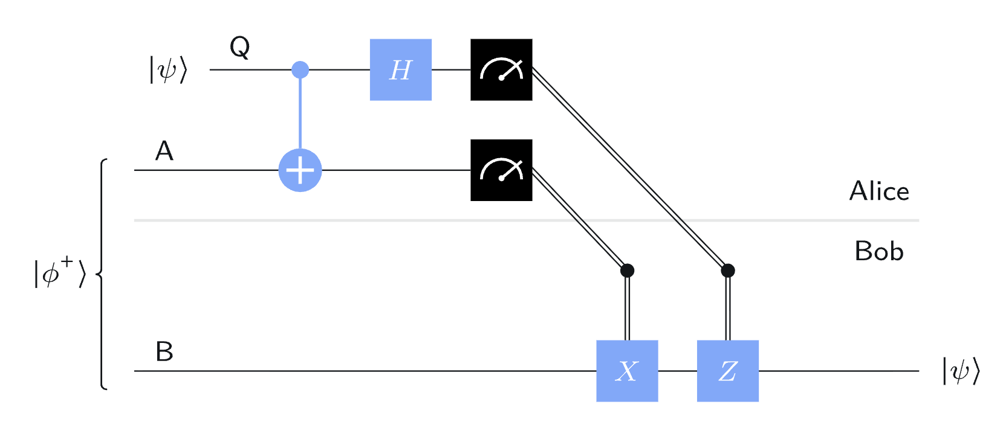
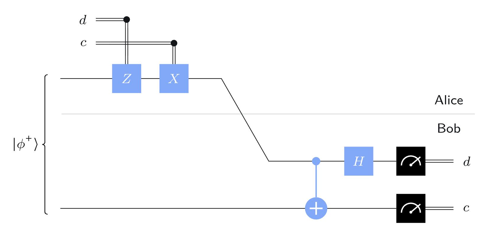
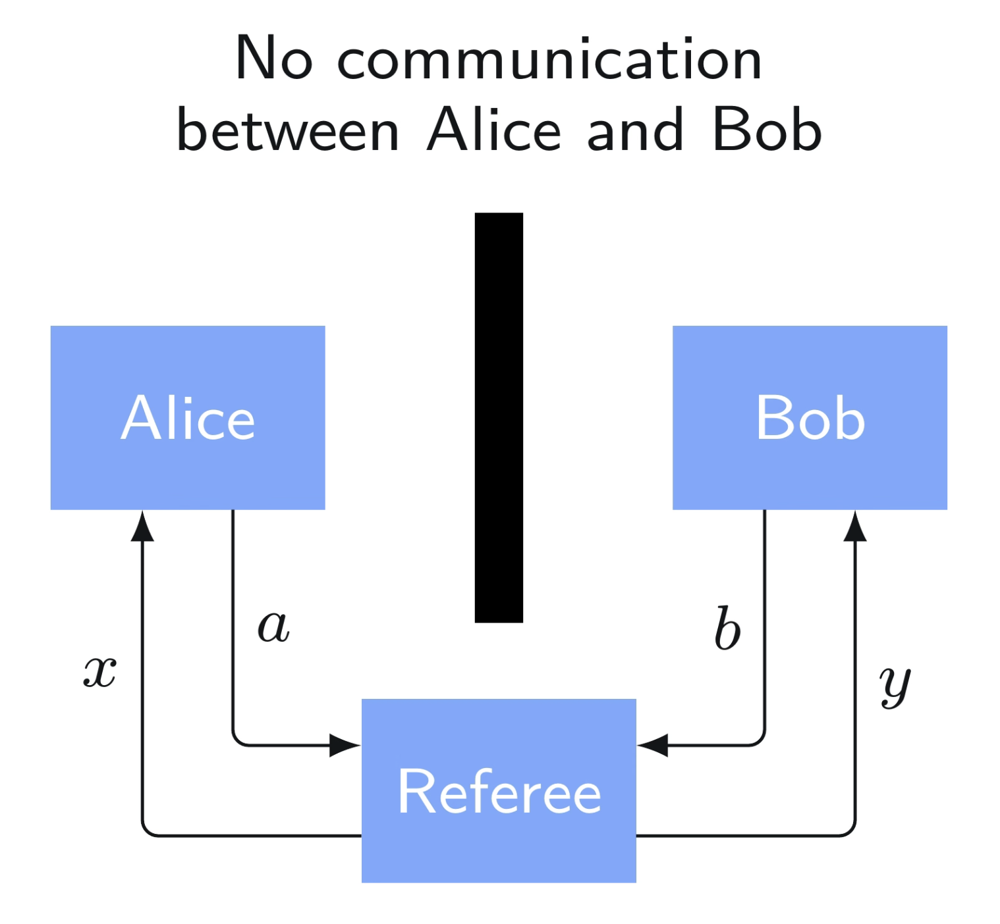
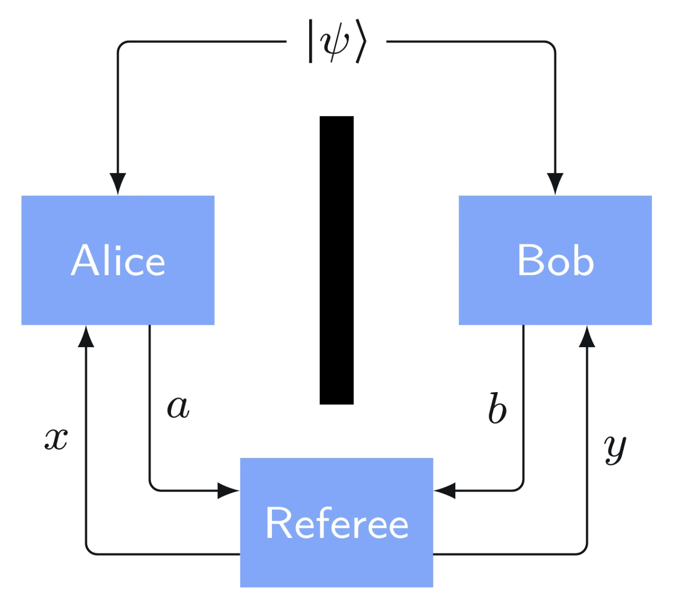

# ⚛️ Basics of Quantum Information — Qiskit Notebooks

> *"Anyone who is not shocked by quantum theory has not understood it."*
> — Niels Bohr

This repository contains hands-on Jupyter Notebooks implementing key concepts from the **Basics of Quantum Information** course by IBM Quantum. Each notebook explores a fundamental protocol in quantum information theory, implemented and simulated using **Qiskit** and **Qiskit Aer**.

---

## 📡 Quantum Teleportation



Quantum teleportation allows the **exact quantum state of a qubit to be transmitted** from one party (Alice) to another (Bob) using only:

- 1 shared **entangled pair** (e-bit)
- 2 classical bits of communication

The qubit itself is never physically sent — only classical information travels, yet the quantum state is perfectly reconstructed on the other side. This is not science fiction; it is a proven consequence of quantum mechanics.

📓 **Notebook:** [`Notebooks/Teleportation_Protocol.ipynb`](Notebooks/Teleportation_Protocol.ipynb)

---

## 🔒 Superdense Coding



Superdense coding is the **complementary protocol** to teleportation. Where teleportation sends 1 qubit using 2 classical bits, superdense coding sends **2 classical bits using just 1 qubit** — again powered by a shared entangled pair.

This protocol demonstrates a remarkable consequence of entanglement: it effectively **doubles the classical information-carrying capacity** of a quantum channel, something that is provably impossible without entanglement (by Holevo's theorem).

📓 **Notebook:** [`Notebooks/Superdense_Coding.ipynb`](Notebooks/Superdense_Coding.ipynb)

---

## 🎮 The CHSH Game

### Classical Bound



### Quantum Advantage



The **CHSH game** is a cooperative game between two players, Alice and Bob, who cannot communicate once the game starts. They each receive a random bit ($x$ and $y$) and must return bits ($a$ and $b$) satisfying:

$$a \oplus b = x \wedge y$$

- The best **classical strategy** wins at most **~75%** of the time.
- The **quantum strategy** using entanglement wins **~85%** of the time.

This gap — known as a **Bell inequality violation** — is one of the most profound results in physics. It proves that quantum mechanics cannot be explained by any local hidden variable theory. The universe is, at its core, non-local.

📓 **Notebook:** [`Notebooks/CHSH_Game.ipynb`](Notebooks/CHSH_Game.ipynb)

---

## 🛠️ Setup

### Requirements

- Python 3.10+
- [Qiskit](https://qiskit.org/) 2.1+
- [Qiskit Aer](https://github.com/Qiskit/qiskit-aer) (local simulator)

### Installation

```bash
# Clone the repository
git clone https://github.com/your-username/Qiskit-BasicsOfQuantumInformation.git
cd Qiskit-BasicsOfQuantumInformation

# Create and activate virtual environment
python3 -m venv .venv
source .venv/bin/activate

# Install dependencies
pip install -r requirements.txt
```

Then open any notebook in VS Code or JupyterLab and run the cells.

---

## 📚 Course Reference

These notebooks are based on the **[Basics of Quantum Information](https://quantum.cloud.ibm.com/learning/en/courses/basics-of-quantum-information)** course available on the IBM Quantum Platform — specifically the *Entanglement in Action* module.

---

## 📄 License

This project is for educational purposes, based on publicly available IBM Quantum learning material.
